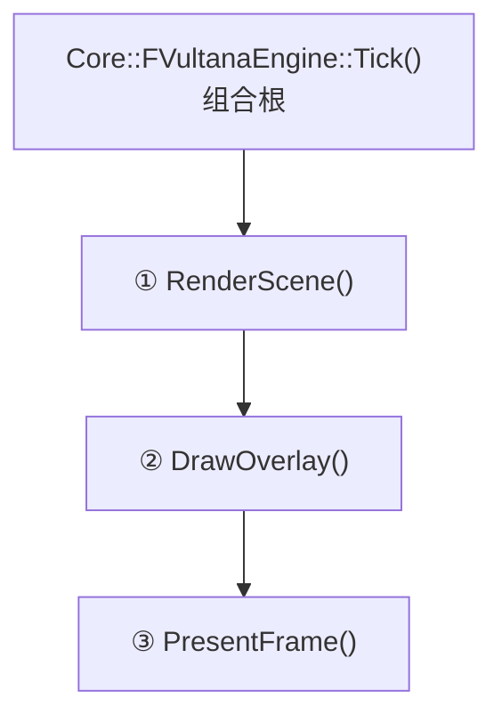

# Slice Pipeline 文档制图规范

> 适用范围：设计、计划或分析文档配图；由 `slice-diagrams` Skill 加载。
> 规范内容直接在本文件中维护；普通问答、目录清单、无配图任务不加载。

**默认用 Mermaid 画图，不用 ASCII 画框。**

| 内容 | 用什么 |
| :--- | :--- |
| 结构 / 分层 / 依赖方向 / 流程 / 时序 | **Mermaid `flowchart`**（确有时序语义才用 `sequenceDiagram`） |
| 渲染图 / 帧图 DAG | Graphviz DOT，复用项目既有 `Tools/GraphViz/` 查看器 |
| 目录布局 | 树形文本（text 围栏），不画成图 |
| 符号 / 方法 / 字段清单 | 无语言代码块（是列表不是图） |
| UI 布局 mockup | **ASCII 文本框**（目标是"像真实界面"，框线比框图更接近观感） |

**硬要求：**

1. **结构图一律 Mermaid，禁止 ASCII 盒子画分层/依赖图。** 三个硬伤：
   - 中英文混排下 `│` 右边框必然对不齐（全角占 2 列、半角占 1 列，宽度不可控）；
   - 改一个词就要重排整块，diff 噪音极大；
   - 无法渲染，读者只能"读"不能"看"。
2. **一张图只表达一件事。** 把"一帧怎么走"和"分层依赖"拆成两张，而不是塞进一张大图。
3. **围栏首行必须是图类型关键字**——DSH 渲染硬约束，违反则整块**退回源码显示、不出图**：
   - 合法首词：`flowchart` `sequenceDiagram` `classDiagram` `stateDiagram` / `stateDiagram-v2` `erDiagram` `gantt` `pie` `journey` `timeline` `mindmap` `gitGraph` `quadrantChart` `requirementDiagram` `c4Context`/`c4Container`/`c4Component`/`c4Dynamic`/`c4Deployment` `block` `packet` `architecture-beta` `sankey-beta` `xychart-beta` `zenuml`。
   - **禁止作为首行**：`graph`（旧式关键字，一律改写为 `flowchart`）、`%%{init: ...}%%` 或 `%%` 注释、YAML frontmatter（`---`）、`block-beta`。
   - 原因：DSH 的 Shiki 没有 mermaid 语法，围栏走 plain 兜底，`<code>` 上**不带 `language-mermaid` 类**，渲染插件只能靠首词嗅探——首词不在白名单就识别不到。
   - 需要初始化指令或注释时，写在图类型关键字**之后**的行；主题跟随 DSH 明暗模式，不要用 `%%{init}%%` 强行指定。
4. **节点文字一律加双引号**：`A["文本"]`。不加引号时 `(` `)` `,` `<` `>` 会破坏解析。
5. **换行用 `<br/>`**（Mermaid 默认 `htmlLabels` 支持）。
6. **用 `classDef` + `:::` 按层/按职责上色**，颜色语义在图紧邻下方用一句话说明（例："蓝 = GBuffer 侧，绿 = HZB 侧"）。
7. **图后必须跟「关键点」文字**，点名图上最容易被忽略的那条边/那个方向——**图负责"看见"，文字负责"理解"**。
8. **交付前做结构校验**（无渲染器时）：首行是合法图类型（见第 3 条白名单）；引号数为偶数；`[]` 配对平衡；标签内无未转义的 `<` `>`（`<br/>` 除外）。
9. **如实声明验证程度**：只做了结构校验就说"未渲染验证"，不得声称"图没问题"。
10. **同一概念的颜色/命名在全文保持一致**，便于跨章节对照。

**反例（真实发生过的）：**

```
┌─ FRendererBase ──────────────── 逻辑控制，零路径知识、零 UI ─┐
│ RenderScene() / PresentFrame()：帧循环拆两半，中间插 UI      │
│ 上传队列 / 交换链提交 / backbuffer blit / WaitGPU            │  ← 右边框对不齐
└────────────────────────────────────────────────────────────────┘
```

同一份文档里几张这样的图，**没有一张的边框是对齐的**；改一次内容就要重新数一遍空格。

**正例（拆成两张，各表一件事）：**


